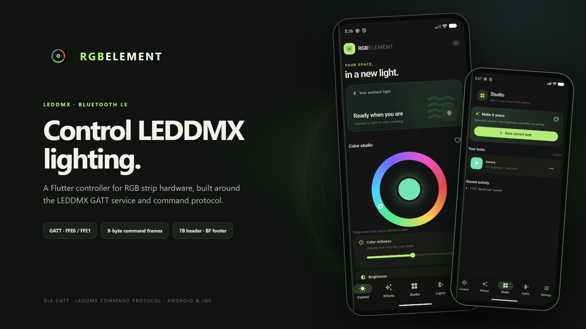
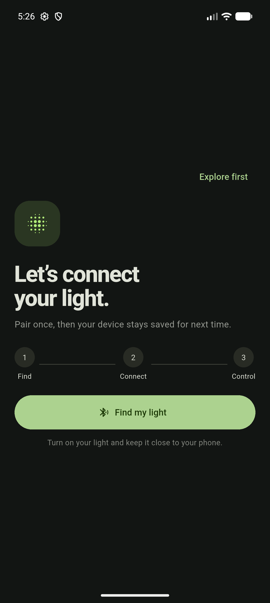
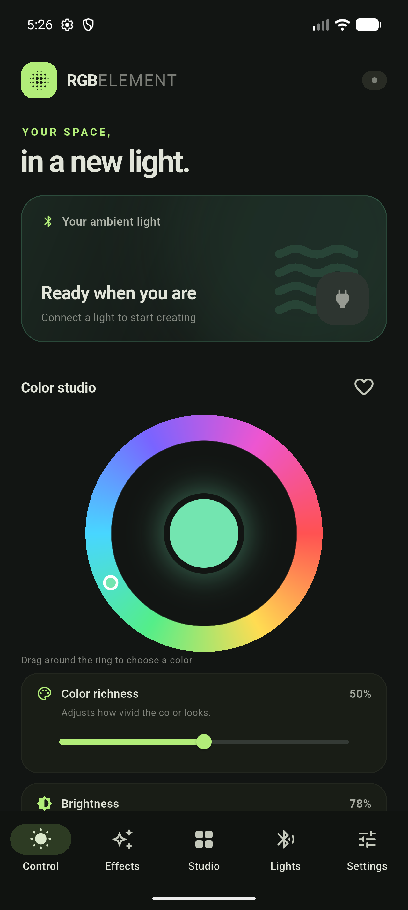
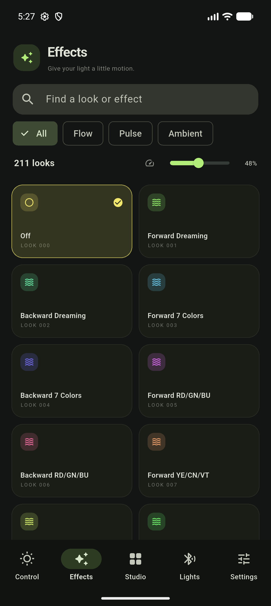
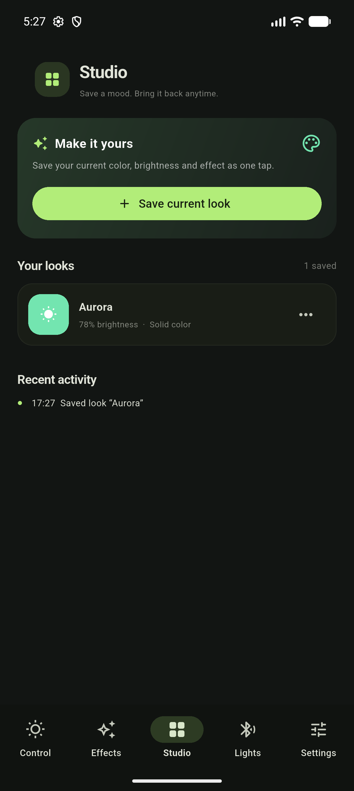

# RGBElement

RGBElement is a Flutter companion for Bluetooth LED strips that use the LEDDMX controller protocol. It turns the findings from a reverse-engineering project into a friendlier mobile controller, with explicit color controls, one-time device setup, and a place to save reusable lighting looks.

The app is under active development. It is configured for Android and iOS; Bluetooth behavior can vary between controller firmware revisions and should be checked with the target hardware.



## Screenshots

Captured from the Android app running in a Pixel 10 Pro emulator. The Control screen is shown without a connected light; the Studio screen includes a sample saved look.

| First-run device setup | Color controls |
|---|---|
|  |  |

| Built-in effects | Saved looks in Studio |
|---|---|
|  |  |

## What it does

- Guides first-time users through Bluetooth permission, device discovery, and connection.
- Remembers the last connected light and attempts to reconnect on app launch or resume. The light remains visible in **Lights** if reconnection needs a manual retry.
- Provides power, hue, color intensity, brightness, white temperature, effect, effect speed, and sound-reactive controls.
- Includes a searchable catalog of 211 built-in effect labels. Names are firmware-dependent hints, not guaranteed descriptions for every strip.
- Saves favorite colors and named looks containing color, brightness, speed, effect, and temperature.
- Includes a color-tour demo, recent activity, dark/light appearance, sleep timer, and firmware compatibility options.
- Uses a native branded launch screen and Material 3 interface.

RGBElement currently controls one active BLE connection at a time. The controller family does not provide dependable state readback, so the app reflects the commands it sends rather than continuously querying the strip.

## Get started

### Requirements

- Flutter and Dart versions compatible with the constraints in [`pubspec.yaml`](pubspec.yaml).
- Android Studio or Xcode for the corresponding platform build.
- A Bluetooth-capable phone and a powered LEDDMX-compatible controller.

### Run on a device

```sh
flutter pub get
flutter run
```

On first launch, choose **Find my light**, select the nearby LEDDMX device, and wait for the connection confirmation. Keep the controller powered and nearby. Close the vendor LED app before connecting because these controllers generally allow only one Bluetooth central at a time. Bluetooth permissions are requested when discovery starts.

To build a local Android debug APK:

```sh
flutter build apk --debug
```

BLE discovery and control require a physical device. A simulator cannot stand in for the strip's Bluetooth connection.

## Project map

| Path | Responsibility |
|---|---|
| [`lib/main.dart`](lib/main.dart) | Onboarding, app shell, control screens, effects, studio, and settings UI |
| [`lib/state/app_state.dart`](lib/state/app_state.dart) | BLE scan/connect lifecycle, reconnect behavior, commands, and preferences |
| [`lib/protocol/leddmx_protocol.dart`](lib/protocol/leddmx_protocol.dart) | LEDDMX frame and command builders |
| [`lib/data/pattern_catalog.dart`](lib/data/pattern_catalog.dart) | Built-in effect labels |
| [`lib/models/light_scene.dart`](lib/models/light_scene.dart) | Saved-look model and serialization |
| [`flutter_native_splash.yaml`](flutter_native_splash.yaml) | Native splash-screen generation settings |

## R&D case study: from LED LAMP to RGBElement

The project began with a low-cost strip controlled by the Android app **LED LAMP** (`com.ledlamp`). The original investigation combined BLE advertisements, GATT inspection, command experiments, public protocol references, and a comparison with the vendor app. The result was a protocol model that could be implemented in a mobile app without relying on the vendor UI.

### Investigation and findings

1. **Established the transport.** USB powers the strip; the investigated unit exposes no USB serial controller. Control is over Bluetooth Low Energy.
2. **Found the device without pairing.** An active scan saw `LEDDMX-03-CDA0` (advertised manufacturer ID `0x0642`). The device did not need—and did not support—Bluetooth bonding. Its advertisement did not include service UUIDs.
3. **Mapped the GATT control channel.** The tested family uses service `FFE0` and writable characteristic `FFE1`. Writes are sent without a response.
4. **Decoded the command framing.** Control messages are fixed nine-byte frames starting with `0x7B` and ending with `0xBF`; using the more familiar `0x7E`/`0xEF` framing silently fails.
5. **Cross-checked firmware differences.** Public LEDDMX references, the vendor app, and tests on the LEDDMX-03 family reveal variation in frame padding, power bytes, and the fourth color data byte. RGBElement exposes the known variants in Settings instead of assuming every controller is identical.
6. **Identified platform limits.** On the original Windows host, BLE connection and service discovery could succeed while characteristic enumeration failed for this controller. Other BLE devices worked on that host. This isolated a controller/Windows-stack compatibility issue; the mobile app uses the phone's BLE stack instead.

The vendor LED LAMP 4.3.7 APK was also inspected with JADX. Its BLE code connects without bonding and starts service discovery after the GATT connection. Different code paths emit both `7B FF` and `7B 04` frames; the LEDDMX-03 RGB paths also use both `00` and `FF` for the fourth color data byte. That evidence explains why RGBElement keeps frame style and color-byte choices configurable rather than baking in a single combination.

The R&D notes describe one investigated controller and firmware family. They should not be read as a guarantee that every product sold under an LEDDMX name has identical behavior.

### Command frame

The standard frame is:

```text
7B FF <command> <data 1> <data 2> <data 3> <data 4> <data 5> BF
```

Unused data bytes are padded with `FF`. RGBElement also supports `04` in place of the standard `FF` frame byte for controllers that expect the alternate form.

| Function | Command | Data / notes |
|---|---:|---|
| Brightness | `01` | Percentage `0–100` plus an adjustment byte (`percentage × 32 / 100`) |
| Effect speed | `02` | Percentage `0–100`; higher values are faster |
| Built-in effect | `03` | Index `0–210`; `0` is Off |
| Power | `04` | Investigated LEDDMX-03: `01` on / `00` off; some older units use `03` / `02` |
| RGB color | `07` | Red, green, blue, and a firmware-dependent data byte (`00` or `FF`) |
| White temperature | `09` | Percentage `0–100` plus adjustment byte |
| Sound-reactive mode | `0B` | `00` off; nonzero enables a mode |

Brightness is internally quantized to roughly 32 levels on the investigated controller, so the effective output may change in visible steps even though the app accepts a 0–100 value. Effect labels also differ between firmware variants. Custom patterns documented for some LEDDMX-00 units did not work on the tested LEDDMX-03 unit, so they are not presented as a supported feature.

## Connection and troubleshooting

- Keep only one controller app connected to the strip at a time; disconnect LED LAMP or another BLE client before using RGBElement.
- If the light does not appear, make sure it is powered, nearby, and advertising. Some controllers stop advertising after repeated failed connections; unplugging USB power for about 10 seconds can reset them.
- If a connection succeeds but commands have no effect, try the **Frame style**, **Power command**, and **Color byte 7** options in Settings. Change one option at a time.
- A saved device is remembered by its Bluetooth identifier. Operating-system Bluetooth permission, force-stop behavior, or radio-state changes can prevent automatic reconnect; use **Reconnect** on the Lights screen when needed.
- The app cannot confirm the strip's actual power, color, or effect state because the investigated protocol has no reliable state readback.

## Licensing note

The app currently uses [`flutter_blue_plus`](https://pub.dev/packages/flutter_blue_plus) with `License.nonprofit`. This supports the package's non-commercial use terms. Before commercial distribution, review the package's current license and obtain the appropriate license or replace the BLE dependency.

## Research references

- [LEDDMX-00 reference implementation and effect list](https://github.com/user154lt/LEDDMX-00)
- [LED Control for Mac protocol notes](https://github.com/Pbharathwajan/led-control-mac/blob/main/docs/PROTOCOL.md)
- [LEDDMX BLE Home Assistant integration](https://github.com/PUMPKIN97-svg/leddmx-ble-homeassistant)
- [LED LAMP on Google Play](https://play.google.com/store/apps/details?id=com.ledlamp)
